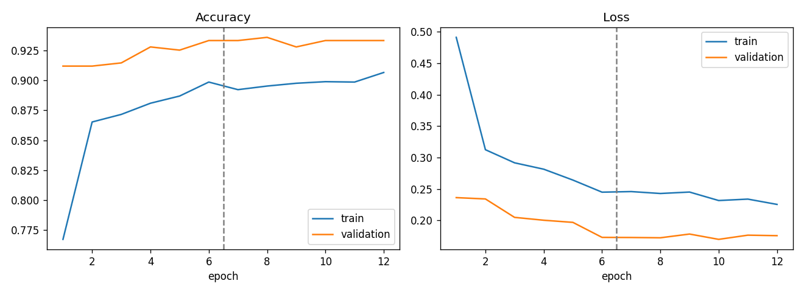

# ESP32 Cat vs Dog Classifier

Image classifier that runs on a Seeed XIAO ESP32S3 Sense. A MobileNetV2 model is trained on a laptop, quantized to int8, and runs on the board with TensorFlow Lite Micro. Inference happens on the ESP32, not the laptop.



About 93% validation accuracy (MobileNetV2, alpha 0.35, 96x96 input).

## Two versions

| Sketch | How it connects |
|---|---|
| `esp32/cat_dog_cam` | Wi-Fi. Serves a web page with live video and a "Take image" button |
| `esp32/cat_dog_usb` | USB serial. Driven by the desktop app in `laptop/` |

## Train

Python 3.11 or 3.12.

```
cd training
python -m venv .venv
.venv\Scripts\activate
pip install -r requirements.txt
python train.py --limit 3000    # quick run
python train.py                 # full run
python predict.py photo.jpg     # test on your own images
```

`train.py` downloads the Cats vs Dogs dataset, fine-tunes MobileNetV2, quantizes to int8, and writes `model_data.h` into both sketch folders. A trained model is already included.

## Flash

Arduino IDE 2.x with **esp32 by Espressif** 3.x and the **tflm_esp32** library. Board: XIAO_ESP32S3, PSRAM: OPI PSRAM.

- **Wi-Fi version:** set `WIFI_SSID` / `WIFI_PASS`, upload, then open the IP shown in Serial Monitor. If it can't join, it creates its own `CatDogCam` network.
- **USB version:** upload, close Serial Monitor, then run:

```
cd laptop
pip install -r requirements.txt
python cat_dog_gui.py            # or --simulate to try without hardware
```
